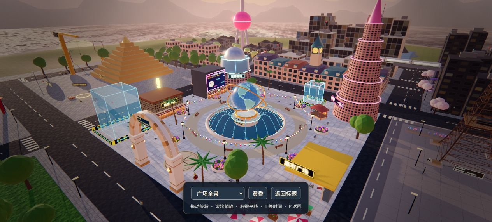
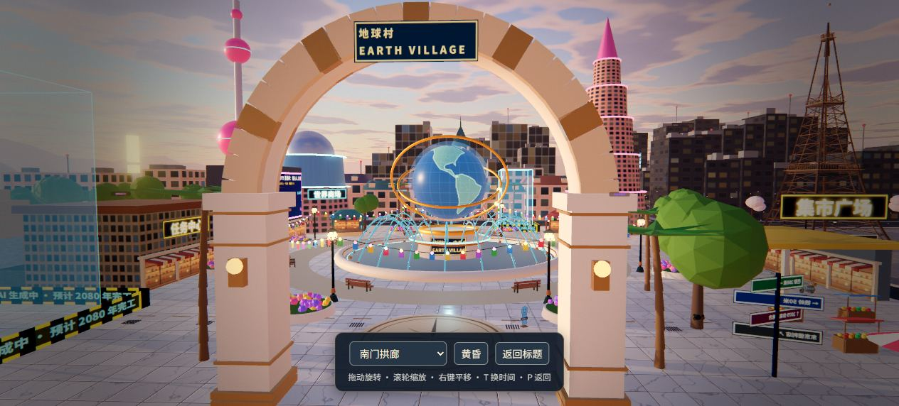

<!--
  首屏视觉：真实运行截图，不是设计稿、不是库存图。
  来源：node tools/qa/check_entries.mjs（无头 Chrome，2026-11-18，1264×572，未裁切、未调色）
  正本：docs/shots/20261118/entry_A_plaza.jpg（来源登记见 docs/shots/README.md）
-->

**网页 3D 游戏** · 原生 JS ESM + vendored Three.js r187 · 运行时零 npm 依赖 · 不联网

# 活人感 2079 · 重制版

> AI 把活干完了 · 你负责活着



**给想笑三分钟的人一个不用装、不用联网、双击就开的 3D 小游戏**：一只奶蛙骑电驴把「活人感」从 3% 骑回 100%，
八个街区、八个小任务、一条 195 秒的主线，全在一个 3.8 MB 的 HTML 文件里。

仓库本身是给接手方和同事的：能跑、能改、能验收。下面三张图都是实机截图，不是设计稿。

双击 `scripts/launch/启动游戏.bat`（Windows）或 `scripts/launch/启动游戏.command`（macOS），
点「点击投胎」，三分钟后你在自由闯荡。

---

## 三个地标：这个项目长什么样

### 一、地球村：八个街区的地标挤在同一个岛上



金字塔、比萨斜塔、东京塔、西方明珠塔、南侧海滩，全部在同一个岛上（海岸线半径约 320 米，城区 336×336 米），各自带一条街。
**它证明了首屏那句「八个街区」不是八张地图**——所以大苹果的外卖冲刺能在 105 秒里横穿全岛送完四单，
地铁口写着「终点站：铁岭」，进去就落到西南角老家门楼。

### 二、东京便利店街：HUD 就是玩法说明书


送单途中按 `P` 进观景、再点「继续游戏」回来的实机画面，一帧没动。
左上 15 步新手指引走到第 10 步，右上活人感 20%，右侧人生任务打勾、街区任务列全八个，
中间弹幕在刷「我的刀盾！」，底部字幕条写着「东京的雨是付费天气，只下在这条街」。

**它证明了「不用读文档就能玩」**：所有状态都在屏幕上，`docs/怎么玩.md` 只是备份。

### 三、离线单文件：3,806,026 字节，`file://` 双击就玩

```console
$ npm run build
E:\活人感2079-重制版\dist\活人感2079.html (3,806,026 bytes, 181 ms)

$ npm run build:viewer
E:\活人感2079-重制版\dist\地球村-自由浏览.html (828,468 bytes, 172 ms)
```

单文件版把 Three.js、全部代码、程序化贴图和代码画的模型塞进一个 HTML，不读 GLB、不发一个请求。
`node tools/qa/check_offline.mjs` 用 `file://` 打开它，确认能启动、八个街区齐全、零报错。


**它证明了「零依赖」不是口号**：`package.json` 里没有 `dependencies` 字段，`vendor/three/` 是 r187 原始分发副本，
断网、拔网线、拷到 U 盘，双击照样玩。

---

## 八个街区，八个小任务

天黑之后或大结局后的「自由闯荡」才能接。骑电驴站进彩色光圈按 `E`，做完做砸都涨活人感。

| 街区 | 当地任务 | 类型 | 时限 | 活人感 |
|---|---|---|---|---|
| 魔都弄堂（西北） | 咖啡店打工：撞飞 8 个挡门口拍照的网红 | 打 | 75 s | +12 |
| 东京便利店街（东北） | 赶末班电车：集 3 张票上站台，人生贩卖机会掉亲戚拦你 | 躲 | 75 s | +12 |
| 大苹果（东南） | 外卖冲刺：全岛送 4 单 | 送 | 105 s | +14 |
| 热带海滩（南） | 沙滩躲亲戚：躲进发光遮阳伞，被问 3 次就输 | 躲 | 60 s | +12 |
| 巴黎 | 法棍骑士挑战赛：撞飞 6 名法棍斗士 | 撞 | 75 s | +15 |
| 金字塔工地 | 给法老搬砖：送四趟千年加急砖 | 送 | 90 s | +14 |
| 冰岛温泉 | 极光团建打卡：冰屋、温泉、火山三处打卡再回考勤机销假 | 跑图 | 75 s | +12 |
| 老家县城 | 逃不掉的早读：送拌粉并背完课文 | 送 | 90 s | +15 |

数值来自 `src/world/districts/*.js` 里每个街区的 `quest` 定义，不是文档抄的。

---

## 怎么开始

需要 **Node.js ≥ 20.19**（只用它起静态服务和跑工具链，游戏本身不需要构建）。

```bash
git clone https://github.com/flying-dragon-ai/huorengan-2079.git
cd huorengan-2079
git lfs install && git lfs pull     # 模型/音频/图片走 Git LFS
npm ci                              # 只装开发期工具（eslint / prettier / vitest / esbuild）
npm run dev                         # → http://127.0.0.1:2079/index.html
```

不想装 Node：`dist/活人感2079.html` 双击即可（模型由代码生成，画质略低于标准版）。

| 入口 | 地址 | 说明 |
|---|---|---|
| 标准版 | `/index.html` | 带 Lux3D / Tripo 生成的 GLB 模型 |
| 自动演示 | `/index.html?auto=1` | 点一下画面，机器人从开场玩到结局，约 3 分半 |
| 开发跳关 | `/index.html?dev=1` | 控制台 `__game.dev.jump(x,z)` / `.tp(x,z,yaw)` / `.ride(x,z)` |
| 观景版 | `/viewer.html` | 自由浏览，独立入口，共用 `vendor/` |
| 离线单文件 | `dist/活人感2079.html` | `file://` 直接双击，模型由代码生成 |

操作：`WASD` 移动 · 鼠标转镜头（先点一下画面）· `空格` 跳（空中再按是二段跳）· `Shift` 加速 ·
`E` 上下电驴 / 接街区任务 · `Q` 捧腹大笑（笑点满了才能用）· `M` 大地图 · `H` 操作说明 · `R` 回到路上。

---

## 边界与当前状态

**能跑通的**：主线从人生舱大厅到自由闯荡（195 秒，零控制台报错）、八个街区任务全部可完成、
两个观景入口、离线单文件、135 条单测、CI 门禁。

**还不能宣称的**：

- **奶蛙动作逐段切换与内存峰值没有专项验收。** 主角已切到 `naiwa_animated.glb`（本地烘的 6 段动作），
  主线回归零报错，但逐段切换的接缝和峰值内存还没测。下一步：`tools/qa/check_memory.mjs` 跑一遍六段动作。
- **第三方绑骨路线已放弃。** 自动绑骨连续拒绝抱腹姿态（`MODEL_NOT_RIGGABLE`），重定向报
  `TARGET_SKELETON_PROFILE_UNSUPPORTED`，已停止重复扣费。动作只能本地用 Blender 烘。
- **参考图没有逐图对照复刻。** `docs/参考图/` 那 12 张是美术目标，不是已实现效果，别拿它们当截图。
- **三个重构前就存在的 bug 按「行为保持」原则没修**，记在 `docs/交接说明.md` 第 9 节：
  `Timeline.update` 按注册顺序而非到期时间触发；`smooth(a,b,x)` 在 `a === b` 时返回 `NaN`；
  `districts.finish()` 在没有 active 任务时靠 `TypeError` 挡住重复结算。三处都写了修法，等排期。
- **视觉待办**：冰岛水陆过渡与夜景、巴黎橱窗纵深、东京立体店面。
- **素材授权未逐项核实**，所以仓库是私有的，不对外发布。逐项状态见 `assets/来源.md`。
- **无头验收的 fps 不作门禁**：波动太大，只作参考。门禁口径是零 error / warning + 状态推进到 `free` + `meter`/`gags` 与基线一致。

---

## 开发命令

| 命令 | 作用 |
|---|---|
| `npm run dev` | 起静态服务（127.0.0.1:2079，no-cache）。`--port N` 或 `SERVE_PORT` 换端口 |
| `npm run lint` | ESLint flat config，零 error 为通过 |
| `npm run format` | Prettier 格式化（`vendor/ assets/ dist/` 已忽略） |
| `npm test` | Vitest 单测，纯逻辑，不依赖 WebGL/DOM |
| `npm run build` | 打 `dist/活人感2079.html` 单文件 |
| `npm run build:viewer` | 打 `dist/地球村-自由浏览.html` 单文件 |
| `npm run check` | lint + test + 两个 build，CI 同款门禁 |
| `npm run test:e2e` | 无头 Chrome 机器人验收（需先 `npm run dev`） |

### 单文件构建的两个坑

1. **不要打开标识符重命名。** `scripts/build-singlefile.mjs` 只用 `minifyWhitespace + minifySyntax`。
   在 `vendor/three` 的体积下 esbuild 的 identifier mangling 会卡死——这是历史根因，别改回去。
2. **`</script` 必须转义。** 内联脚本里出现未转义的 `</script` 会提前闭合标签。

---

## 测试

```console
$ npm test
 ✓ tests/unit/math.test.js (29 tests) 60ms
 ✓ tests/unit/config.test.js (12 tests) 6ms
 ✓ tests/unit/model-registry.test.js (11 tests) 66ms
 ✓ tests/unit/text.test.js (17 tests) 17ms
 ✓ tests/unit/guide.test.js (14 tests) 15ms
 ✓ tests/unit/districts.test.js (26 tests) 12ms
 ✓ tests/unit/util.test.js (11 tests) 8ms
 ✓ tests/unit/quest-config.test.js (15 tests) 11ms

 Test Files  8 passed (8)
      Tests  135 passed (135)
   Duration  1.28s
```

`model-registry.test.js` 会校验 22 个 GLB 是否真的落盘，`guide.test.js` 跑路网最短路。

机器人验收（本机 Chrome 无头模式，Node 22+ 自带 WebSocket，不用装包）：

```bash
node tools/qa/check_full.mjs                  # 自动演示：大厅 → 自由闯荡，零控制台报错
node tools/qa/check_entries.mjs               # 两个观景入口
node tools/qa/check_district.mjs tokyo        # 单个街区：任务 + 笑点 + 大地图
node tools/qa/check_offline.mjs               # file:// 打开单文件，八个街区齐全
```

`CHROME_PATH` 可覆盖 Chrome 路径，`BASE_URL` 可覆盖被测入口，截图落在 `tests/e2e/shots/<日期>/`。

---

## CI

[](https://github.com/flying-dragon-ai/huorengan-2079/actions/workflows/ci.yml)

- `.github/workflows/ci.yml` —— push / PR：`npm ci` → `lint` → `test` → `build` → `build:viewer`，产物上传为 artifact。
- `.github/workflows/e2e.yml` —— 手动触发：装 Chrome，跑机器人验收（`full` / `entries` / `districts` / `all`）。

---

## 目录结构

```
src/
├── main.js                  启动编排：加载进度、标题、跳过开场
├── core/                    config（路网/全局调参）· paths（资源基址）· math · util · input
├── data/                    text（台词/梗）· model-registry（MODEL_CONF）· quest-config
├── gfx/                     pipeline · environment · textures · fx · shaders
├── world/                   island（门面）· terrain · roads · buildings · props · colliders · beach
│   └── districts/           8 个街区组件 + kit · detail · plaza · refinements
├── actors/                  player · camera-rig · models · figurines · npc/
├── game/                    game（门面/主循环）· mission · auto-pilot · wanted · quality
│                            districts · ui · guide · hall · photo
├── audio/                   audio
└── viewer/                  观景版（独立入口 viewer.html）

assets/      GLB 模型、音效、图片（Git LFS）
vendor/      Three.js r187 整包，不联网
tools/       qa（无头 Chrome 验收）· assets（离线资产管线 + blender bpy 脚本）· lux3d（依赖声明）
scripts/     serve · build-singlefile · build-viewer · launch（双击启动器）
tests/unit/  Vitest 纯逻辑单测
docs/        交接说明 · 开发日志 · 开发计划 · 怎么玩 · 架构 · 参考图 · shots（README 用图）
dist/        单文件发布件
```

### 分层与依赖方向

```
main ──▶ game ──▶ world ──▶ gfx ──▶ core
          │        │         │        ▲
          ├──▶ actors ───────┘        │
          ├──▶ audio ─────────────────┤
          └──▶ data ──────────────────┘
```

- `core/` 与 `data/` 不依赖任何上层模块，是唯一被所有人引用的底座。
- `world/` 不 import `game/`；`game/guide.js` 与 `game/ui.js` 从 `core/config.js` 取路网常量，
  不再反向 import `world/island.js`。
- `Island` 与 `Game` 是**门面类**：对外字段与方法签名稳定，内部把方法体委托给拆出的模块
  （`buildTerrain(island)`、`updateMission(game, dt)` 这类自由函数），因此拆分不改变任何算法。
- 资源路径集中在 `core/paths.js`，不再散落 `../../assets` 硬编码。

---

## 素材与许可

本仓库为**私有**仓库。代码与素材的权利状态见 `LICENSE` 与 `assets/来源.md`；
其中部分素材的授权尚未逐项核实，因此不对外公开发布。
`vendor/three/` 为 Three.js r187 原始分发副本，遵循其自身的 MIT 许可证，仅覆盖该目录。

接手前先读 `docs/交接说明.md`（现状、目录逐文件释义、已知问题）和 `docs/开发日志.md`（按日期的运行记录）。
